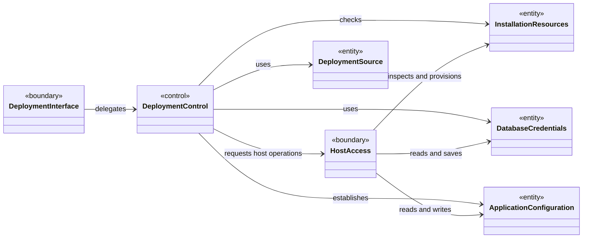
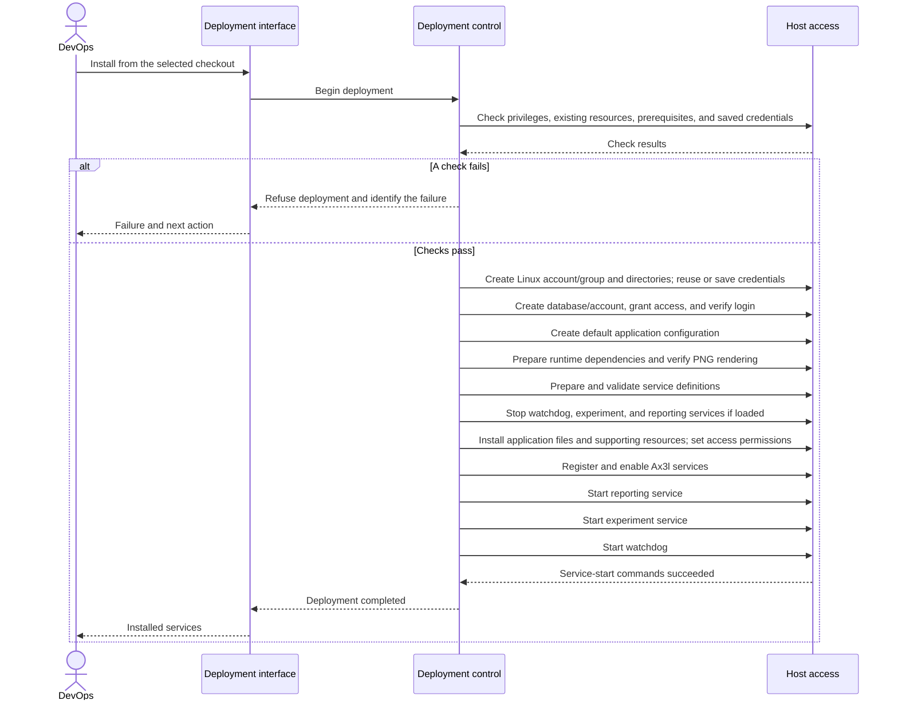

# UC-01: Deploy Ax3l software — Analysis realization

[Use case](../use-case/uc-01-deploy-ax3l-software.md) ·
[Analysis View](index.md) · [Glossary](../glossary.md)

**Status:** Initial draft, checked against the current installation code.

## Participants and responsibilities

These are conceptual analysis elements. Their responsibilities are currently
distributed across installation scripts and supporting helpers.

| Participant | Analysis role | Responsibility |
| --- | --- | --- |
| Deployment interface | [Boundary](../glossary.md#boundary) | Accept DevOps' installation request and present usage, progress, failures, and completion. |
| Deployment control | [Control](../glossary.md#control) | Sequence checks, provisioning, software preparation, and service activation; stop when an operation fails. |
| Host access | Boundary | Inspect and change host resources, access the database service, obtain runtime dependencies, and manage Ax3l's services. |
| Deployment source | [Entity](../glossary.md#entity) | The selected checkout's application files, dependency requirements, and supporting resources. |
| Installation resources | Entity | The host's Ax3l directories, Linux account/group, database/account, and service definitions. |
| Database credentials | Entity | Validated or generated connection settings and password, stored separately from application configuration. |
| Application configuration | Entity | Listener settings and the inference-service address used by the installed application. |

Installation resources describe actual host state. Deployment does not maintain
a persistent deployment record or transaction covering these resources.

## Main collaboration

DevOps selects the checkout before invoking deployment. The deployment control
uses that source throughout the following collaboration.

The successful branch assumes each operation succeeds. The deployment control
stops at the first failing operation; later operations are not attempted.

## Decisions and failure behavior

| Situation | Deployment control's decision |
| --- | --- |
| An [existing installation](../glossary.md#existing-installation) is found | Refuse before provisioning and refer DevOps to [UC-03](../use-case/index.md#use-cases). |
| Only saved [database credentials](../glossary.md#database-credentials) remain | Validate and reuse them; create a new database account with that password. |
| Provisioning, configuration, runtime preparation, or service validation fails | Stop. Completed provisioning may remain. |
| File installation or service activation fails after stopping services | Stop. Files may be partly installed and services partly started; there is no automatic rollback. |
| All service-start commands succeed | Report completion. Application health and a successful experiment are not verified by deployment. |

Help and unsupported arguments are handled at the deployment interface before
host operations. Help succeeds; unsupported arguments fail.

## Traceability

| UC-01 main-flow steps | Analysis responsibility |
| --- | --- |
| 1 and 9 | Deployment interface receives the request and reports the outcome. |
| 2 | Deployment control checks installation eligibility through host access. |
| 3–5 | Deployment control provisions resources and establishes credentials and configuration through host access. |
| 6–7 | Deployment source supplies the requirements and resources for runtime preparation, validation, and file installation. |
| 8 | Deployment control activates the prepared services through host access in the required order. |

[EXT-01](../use-case/index.md#external-use-cases) remains a DevOps-arranged
precondition, outside this collaboration.

## Code basis

The responsibilities and ordering were checked against
[installation](../../scripts/install.sh),
[service installation](../../scripts/install-services.sh),
[service configuration](../../scripts/service-configuration.sh),
[application configuration](../../ax3l/interface/Configuration.py),
[service control](../../scripts/services.sh).

## Design realization

[Deployment design](../design/uc-01-deploy-ax3l-software.md) maps these participants
to concrete scripts, functions, configuration classes, and service contracts.
