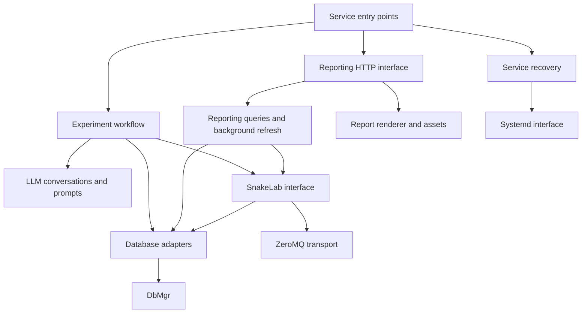

# Application structure

[Implementation View](index.md) · [Coding guidelines](../../pages/coding-guidelines.md)

The application has three processes: experiments, HTTP reporting, and service
recovery. Each process has a small composition entry point under
[server/](../../ax3l/server/).

| Location | Responsibility |
| --- | --- |
| [app/experiment/](../../ax3l/app/experiment/) | Sequence evaluation, proposals, submission, comparison, and checkpoints. |
| [app/reporting/](../../ax3l/app/reporting/) | Read report data and refresh summaries and animations in the background. |
| [CheckServices.py](../../ax3l/app/CheckServices.py) | Recover stopped application services through the systemd interface. |
| [activity/](../../ax3l/activity/) | Calculate metrics, distributions, and configuration transformations. |
| [entities/](../../ax3l/entities/) | Hold experiment state, view definitions, and proposals. |
| [interface/](../../ax3l/interface/) | Validate configuration and bridge HTTP, LLM, SnakeLab, systemd, and file access. |
| [interface/database/](../../ax3l/interface/database/) | Own queries, event persistence, schema initialization, and database mechanics. |
| [presentation/](../../ax3l/presentation/) | Render prompts and reports, keeping templates and fonts beside their renderers. |
| [zmq/](../../ax3l/zmq/) | Own socket lifecycle, framing, and bounded request/reply transport. |

## Runtime contracts

- Each experiment evaluates four views before assembling four proposals.
  Checkpoints retain accepted work. An uncertain simulation submission is
  reconciled against stored runs and is never automatically resubmitted.
- Event envelopes, messages, and optional high-score records commit together
  through [EventLogDb](../../ax3l/interface/database/EventLogDb.py).
  [DbMgr](../../ax3l/interface/database/DbMgr.py) alone owns connections, cursors,
  SQL execution, and transactions. Its constructor still initializes the shared
  event schema unless explicitly disabled.
- Reporting summarizes completed runs once, rechecks older unfinished runs,
  and counts distinct compared runs as experiments. A single transaction and
  state-row lock protect each refresh. SnakeLab source data is read only.
- Reporting serves cached totals while separate workers refresh totals,
  service status, and animations. HTTP requests do not generate animations.
- Configuration and protocol validation stay at their interfaces. Internal
  callers use the resolved values. SnakeLab's wire protocol is unchanged.

## Verification

Run `.venv/bin/python scripts/test.py` for the complete suite with a disposable
MariaDB instance and local HTTP/ZeroMQ fixtures. The runner creates its own
credentials and removes its data directory on exit. It requires MariaDB server
and client tools. No deployed inference, SnakeLab, or systemd service is used.

The public service commands and `python -m ax3l.app.ReportingRefresh` remain
available. Internal imports use the owning modules directly. Retired parameter
searches, analysis plots, and checkpoint conversion paths have been removed.
