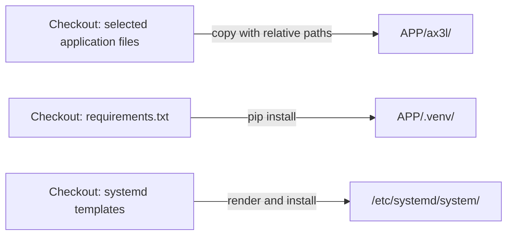

# UC-01: Deploy Ax3l software — Implementation realization

[Design realization](../design/uc-01-deploy-ax3l-software.md) ·
[Use case](../use-case/uc-01-deploy-ax3l-software.md) ·
[Implementation View](index.md) · [Glossary](../glossary.md)

**Status:** Initial implementation, verified against the deployment tests.

## Source organization

| Source | Delivery role |
| --- | --- |
| [install.sh](../../scripts/install.sh) | Fresh-installation entry point. |
| [install-services.sh](../../scripts/install-services.sh) | Orchestrates runtime preparation, file installation, and service activation. |
| [install-progress.py](../../scripts/install-progress.py) | Reports elapsed-time activity during virtual-environment creation and package installation while preserving command output and exit status. |
| [application-files.sh](../../scripts/application-files.sh) | Owns application-file selection and copying through `install_application_files()`. |
| [service-configuration.sh](../../scripts/service-configuration.sh), [services.sh](../../scripts/services.sh) | Configuration and service rendering and lifecycle commands. |
| [Configuration.py](../../ax3l/interface/Configuration.py), [Network.py](../../ax3l/interface/Network.py) | Configuration interfaces copied with the application modules. Defaults remain in [DAx3l.py](../../ax3l/constants/DAx3l.py) and [DDbMgr.py](../../ax3l/constants/DDbMgr.py). |
| [systemd/](../../systemd/), [requirements.txt](../../requirements.txt) | Service templates and Python dependency requirements consumed during installation. |
| [test_install_services.py](../../tests/test_install_services.py) | Deployment regression tests and private MariaDB checks. |

Deployment commands, shell helpers, requirements, and
service templates are used from the checkout. The installed application contains
the selected application files and prepared runtime. Tests and documentation
remain in the repository.

## Application-file installation

The service installer sources `application-files.sh` and calls
`install_application_files()` with the checkout directory, installation directory,
and Linux account name. The helper contains the file-selection and copying
mechanics; service orchestration remains in `install-services.sh`.

The helper preserves relative paths for:

- Python and `*.schema.json` files under [ax3l/](../../ax3l/).
- Markdown under [presentation/prompts/](../../ax3l/presentation/prompts/).
- HTML under [presentation/reporting/templates/](../../ax3l/presentation/reporting/templates/).
- Files under [presentation/reporting/fonts/](../../ax3l/presentation/reporting/fonts/), including its license.

Files are installed with mode `644`, owned by the supplied account and group
(`ax3l` in the deployment workflow). Null-delimited file discovery preserves paths
containing spaces. The helper stages the package inside the installation
directory, then moves it into place. Its subshell owns staging cleanup and the
working-directory change.

The caller enables `errexit` and `pipefail`. Discovery feeds copying through a
pipeline, so a failure in either stage stops installation before service
definitions are installed or services are started. Failed preparation removes
the staged files. Other installation resources can remain after failure.

## Installed layout

In the diagram, `APP` is the fixed application root `/opt/prod/ax3l`.



Installation also creates `APP/conf/ax3l.json` and `APP/games/`. Database
credentials are root-owned with mode `600` in `/etc/ax3l/database.env`; its
directory has group `ax3l` and mode `750`. Application configuration and installed
service definitions have mode `644`.
PNG/GIF rendering uses Pillow; interactive charts are delivered as Plotly HTML.
No server-side browser installation is required.
Rendered service definitions are validated in a temporary directory that is
removed when the service installer exits.

## Runtime entry points

All three service definitions use `APP` as their working directory and currently
run as root.

| Installed service | Python runtime | Module | Runtime inputs |
| --- | --- | --- | --- |
| [ax3l-server.service](../../systemd/ax3l-server.service) | `APP/.venv/bin/python` | [ax3l.server.Ax3lServer](../../ax3l/server/Ax3lServer.py) | Database environment file and the rendered ZeroMQ endpoint. |
| [reporting-server.service](../../systemd/reporting-server.service) | `APP/.venv/bin/python` | [ax3l.server.ReportingServer](../../ax3l/server/ReportingServer.py) | Database environment file, reporting host/port, and `APP/games` as its writable GIF directory. |
| [watchdog.service](../../systemd/watchdog.service) | `/usr/bin/python3` | [ax3l.server.Watchdog](../../ax3l/server/Watchdog.py) | The experiment and reporting unit names, with no database environment file. |

The application package layout and resource paths are preserved, so module
imports and resource loading work from the installed working directory.

## Verification

Run the focused checks, including the private database test:

```sh
AX3L_TEST_INSTALL_DB=1 .venv/bin/python -m unittest discover -s tests -p 'test_install_services.py' -v
```

Omit `AX3L_TEST_INSTALL_DB=1` to skip the database test. That test requires MariaDB
server and initialization tools and uses a private instance with networking
disabled, a private socket, and the disposable `ax3l_test` database/account.

| Design contract | Verification |
| --- | --- |
| Refuse existing installation resources | Directory, service-unit, Linux account/group, database, and database-account cases stop before provisioning. |
| Reuse saved credentials | Fresh installation validates and reuses saved credentials without changing their contents or private permissions. |
| Deliver a working package layout | Tests compare installed assets with the checkout and load configuration, prompts, report templates, and service entry points from the installed tree. |
| Stop on preparation or installation failure | Dependency, service-definition, and file-discovery failures prevent later service activation. |
| Respect service ordering and ownership boundaries | Unit rendering and start/stop calls are checked; independently managed service definitions remain untouched. |
| Provision the application database | Private MariaDB checks verify creation and login, and refusal when the database or account already exists. |

Configuration resolution, package replacement, file copying, permission modes,
and systemd definition validation run for real. Dependency provisioning,
privileged ownership changes, and service-manager actions are stubbed. These
checks do not constitute a live deployment or an end-to-end simulation test.

[EXT-01](../use-case/index.md#external-use-cases) remains external. This
implementation neither performs nor verifies cleanup in the SnakeLab system.
