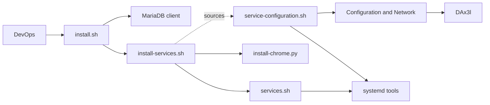
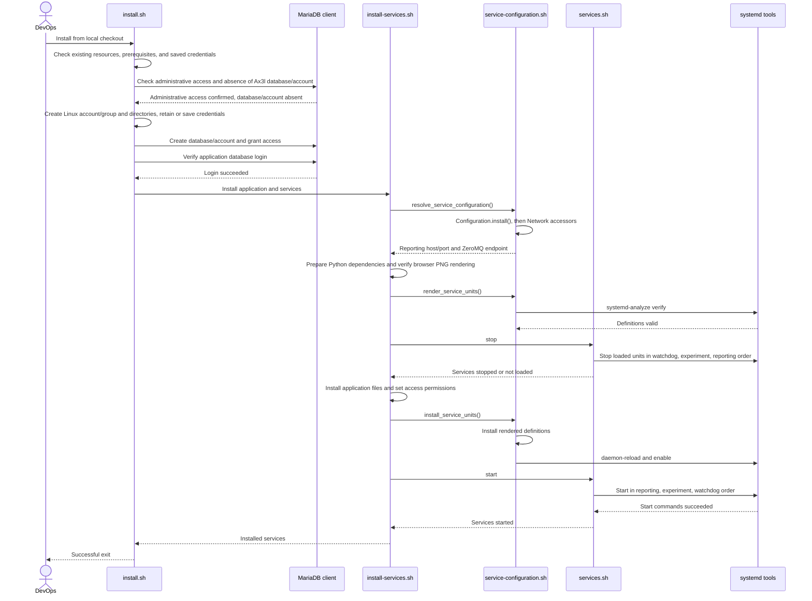

# UC-01: Deploy Ax3l software — Design realization

[Analysis realization](../analysis/uc-01-deploy-ax3l-software.md) ·
[Use case](../use-case/uc-01-deploy-ax3l-software.md) ·
[Design View](index.md) · [Glossary](../glossary.md)

**Status:** Initial draft, checked against the current installation code.

## Analysis to design

| Analysis participant | Design realization |
| --- | --- |
| Deployment interface | [install.sh](../../scripts/install.sh) accepts the request and prints usage, progress, and errors. |
| Deployment control | [install.sh](../../scripts/install.sh) checks eligibility and provisions accounts and storage, then invokes [install-services.sh](../../scripts/install-services.sh) to prepare the runtime, install files, and activate services. |
| Host access | The scripts invoke host commands and the MariaDB client. [service-configuration.sh](../../scripts/service-configuration.sh) renders and registers service definitions, [services.sh](../../scripts/services.sh) controls their lifecycle, and [install-chrome.py](../../scripts/install-chrome.py) provisions and verifies chart rendering. |
| Deployment source | The selected checkout supplies application modules, resources, [requirements.txt](../../requirements.txt), and [service templates](../../systemd/). |
| Installation resources | Directories, Linux accounts, MariaDB resources, and systemd definitions hold the installation state. The installer detects these resources directly. |
| Database credentials | A private connection-settings file is validated and reused or created by [install.sh](../../scripts/install.sh), and retained by [uninstall.sh](../../scripts/uninstall.sh). |
| Application configuration | [Configuration](../../ax3l/interface/Configuration.py) owns the configuration file and its validation. [Network](../../ax3l/interface/Network.py) exposes resolved listener values. Defaults come from [DAx3l](../../ax3l/constants/DAx3l.py). |

The analysis participants span several scripts and functions. They do not
correspond to a new set of Python classes.

The diagram shows principal calls and the sourced shell helper. Host account
and file operations are performed by commands within the scripts.

## Interfaces and ownership

| Interface | Contract |
| --- | --- |
| `install.sh` | Root-only installation from the local checkout, with no deployment arguments. `-h` and `--help` display usage. Existing installation resources cause refusal before provisioning. |
| `install-services.sh` | Requires the provisioned installation directory and credentials. Installs dependencies and application files, then enables and starts the three Ax3l services. |
| `resolve_service_configuration()` | The caller supplies `checkout_dir`, `install_dir`, and `config_dir`. The function creates or validates application configuration through Python and sets `report_host`, `report_port`, and `ax3l_zmq_endpoint` in the calling shell. |
| `render_service_units()` | Uses those paths and listener values to render the three service templates. Sets `unit_dir` and `units`, validates the result, and arranges temporary-directory cleanup when the shell exits. |
| `install_service_units()` | Consumes the rendered units, installs them into systemd's configuration directory, reloads systemd, and enables the services. Starting them is a separate step. |
| `install-chrome.py --app PATH` | Obtains the chart-rendering browser within the application directory and verifies that it can produce a PNG with the expected dimensions. |
| `services.sh start` / `stop` | Root-only service control. Start order is reporting, experiment, watchdog. Stop order is watchdog, experiment, reporting, skipping units that are not loaded. |

The three configuration functions are sourced into the service installer's
shell. Configuration resolution launches a Python child process whose output
contains the reporting host, reporting port, and Ax3l ZeroMQ endpoint.

`Configuration.install()` validates an existing file or writes defaults when
missing. `Network.binding("report")` returns the reporting host and port;
`Network.endpoint()` returns the ZeroMQ listener address. Network caches resolved
configuration within its Python process. A fresh installation creates the
default file; the shared configuration helper also serves other service workflows.

The fresh-install refusal belongs to the installation entry point. The
[upgrade command](../../scripts/upgrade.sh) reuses the service installer to update
an existing installation while retaining its database and configuration.

## Deployment collaboration

The sequence shows the successful path. Each failing command ends its stage and
prevents subsequent stages from running.

## Resource contracts

| Resource | Contract |
| --- | --- |
| Application directory | `/opt/prod/ax3l` contains the installed modules, runtime, chart browser, configuration, and game-image cache. The `ax3l` Linux account/group owns installed application files. |
| Credentials | `/etc/ax3l/database.env` is root-owned with mode `600`. Installation parses exactly five fields: `DB_HOST`, `DB_PORT`, `DB_NAME`, `DB_USER`, and `DB_PASSWORD`. The password is 64 hexadecimal characters. The file is parsed as data. |
| Database | Local `ax3l` database and `ax3l` account at `localhost`. Installation uses administrative socket access, grants full access to the Ax3l database and read access to SnakeLab, then verifies the application login. The database port default comes from [DDbMgr](../../ax3l/constants/DDbMgr.py). |
| Application configuration | `/opt/prod/ax3l/conf/ax3l.json` contains `network.report`, `network.zmq`, and `llamasrv_url`. Validation belongs to `Configuration`. This file is separate from database credentials. |
| Service definitions | The [experiment](../../systemd/ax3l-server.service), [reporting](../../systemd/reporting-server.service), and [watchdog](../../systemd/watchdog.service) templates are rendered into `/etc/systemd/system` with mode `644`. |

All three current service definitions run as root. The experiment and reporting
services receive database settings through systemd's `EnvironmentFile`; the
watchdog does not receive that file. Reporting has write access to the game-image
cache through its service definition.

Uninstall removes the application directory, its configuration and cached images,
the Ax3l database/account, and the Linux account/group. It retains the credentials
file and leaves its directory with root group ownership and mode `700`.

## Failure and completion contracts

- Help returns `0`, unsupported installation arguments return `2`, and explicit
  precondition failures return `1`. Failures in invoked commands propagate their
  failing status.
- Provisioning is not a transaction across host, database, and service resources.
  Completed changes can remain after failure. DevOps uninstalls partial resources
  before a new installation attempt; credentials survive that cleanup.
- Configuration resolution, dependency installation, browser verification, and
  service-definition validation precede the service-stop step.
- Successful service-start commands complete deployment. The service templates
  use `Type=simple`; deployment performs no application-health or simulation check.
- [EXT-01](../use-case/index.md#external-use-cases) is an operator-managed external
  prerequisite. These scripts neither perform nor verify SnakeLab cleanup.

The [installer tests](../../tests/test_install_services.py) cover refusal of
existing resources, credential preservation, configuration and service ordering,
and an opt-in install/uninstall/reinstall cycle against a private MariaDB instance.
