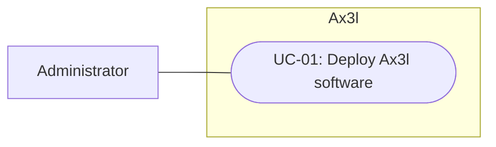

# Use Case View

[Application documentation](../index.md)

**Status:** Initial draft, checked against the current installation code.

## Purpose and scope

The Use Case View describes actors' goals and the application's current
observable behavior. We begin with deploying Ax3l software from a local checkout
onto the same host.

The system boundary includes Ax3l's deployment facilities. Host preparation and
the installation of independently managed applications, including SnakeLab and
LlamaSrv, are outside this use case.

## Actors

| Actor | Role |
| --- | --- |
| Administrator | Deploys Ax3l software on the target host. |

## Use cases

| ID | Goal | Primary actor |
| --- | --- | --- |
| [UC-01](uc-01-deploy-ax3l-software.md) | Deploy Ax3l software | Administrator |

The diagram uses Mermaid flowchart notation to show actors, use cases, and the
system boundary. Lines indicate participation, rather than execution order.
