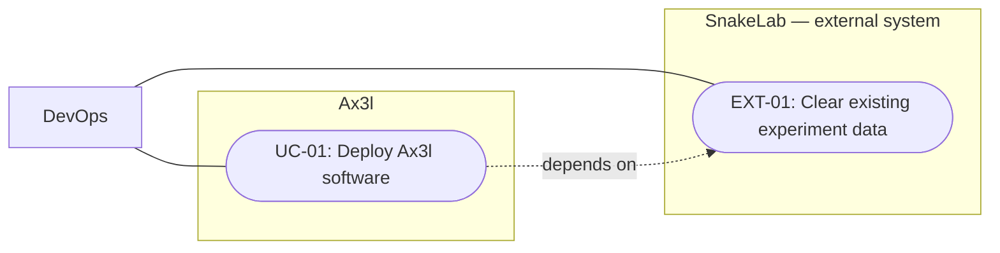

# Use Case View

[Application documentation](../index.md) · [Glossary](../glossary.md)

**Status:** Initial draft, checked against the current installation code.

## Purpose and scope

The Use Case View describes actors' goals and the application's current
observable behavior.

The [system boundary](../glossary.md#system-boundary) includes Ax3l's deployment
scripts. Deployment host preparation and the installation of independently
managed applications, including SnakeLab and LlamaSrv, are out of scope.

## Actors

| Actor | Role |
| --- | --- |
| [DevOps](../glossary.md#devops) | Deploys Ax3l software on the target host. |

## Use cases

| ID | Goal | Primary actor |
| --- | --- | --- |
| [UC-01](uc-01-deploy-ax3l-software.md) | Deploy Ax3l software | DevOps |

## External use cases

| ID | Goal | Owning system | Primary actor |
| --- | --- | --- | --- |
| EXT-01 | Clear existing SnakeLab experiment data | SnakeLab | DevOps |

UC-01 depends on EXT-01 when SnakeLab contains data from an earlier experiment.
This is an external prerequisite, performed separately by DevOps. Its behavior
and implementation are outside this repository.

Solid lines indicate participation. The dashed arrow indicates an external
prerequisite; Ax3l does not perform or verify the SnakeLab cleanup.
