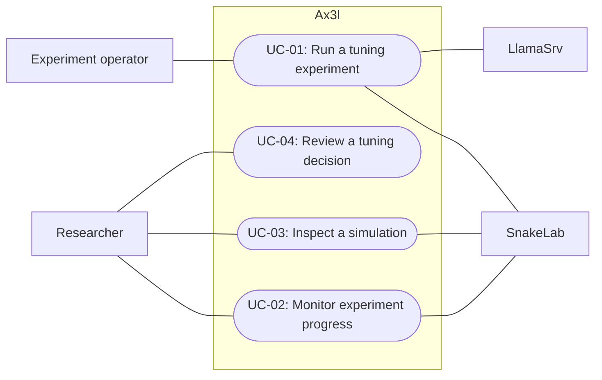

# Use Case View

[Application documentation](../index.md)

**Status:** Initial draft for discussion, grounded in current behavior.

## Purpose and scope

Ax3l coordinates experiments in which a language model proposes Snake AI
settings, SnakeLab runs the simulations, and Ax3l compares and records the
results. Researchers use Ax3l's reports to inspect progress and decisions.

The system boundary includes Ax3l's experiment coordination and reporting.
SnakeLab and LlamaSrv are external applications. Snake training and inference
service management belong to those applications.

## Actors

| Actor | Role |
| --- | --- |
| Experiment operator | Starts or resumes experiments and controls how long they run. |
| Researcher | Reviews progress, simulation outcomes, and tuning decisions. |
| SnakeLab | Runs simulations and supplies their status, results, and captured games. |
| LlamaSrv | Supplies language-model proposals and observations in response to Ax3l's requests. |

One person may act as both experiment operator and researcher.

## Use cases

| ID | Goal | Primary actor |
| --- | --- | --- |
| [UC-01](uc-01-run-tuning-experiment.md) | Run a tuning experiment | Experiment operator |
| [UC-02](uc-02-monitor-experiment-progress.md) | Monitor experiment progress | Researcher |
| [UC-03](uc-03-inspect-simulation.md) | Inspect a simulation | Researcher |
| [UC-04](uc-04-review-tuning-decision.md) | Review a tuning decision | Researcher |

The diagram uses Mermaid flowchart notation to show actors, use cases, and the
system boundary. Lines indicate participation, rather than execution order.

## Terms

| Term | Meaning |
| --- | --- |
| Golden reference | The simulation and configuration used as the current comparison baseline. |
| Trial | A simulation run using a proposed configuration. |
| Experiment cycle | Propose a configuration, run its simulation, compare the result, and collect observations. |
| Tuning perspective | Reward Signals, Architecture, Training, or Exploration: one of the four focused contributions to an experiment. |

Tuning perspectives are distinct from the four documentation views.

## Basis

The initial descriptions follow the existing [runtime behavior](../../pages/runtime-behaviour.md)
and [architecture](../../pages/architecture.md), checked against the current
experiment and reporting behavior.
